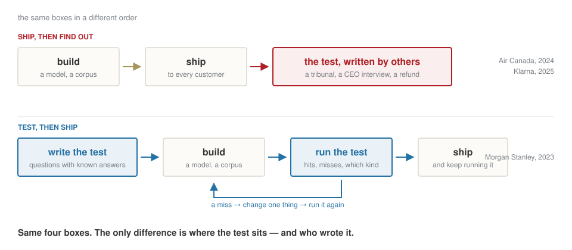
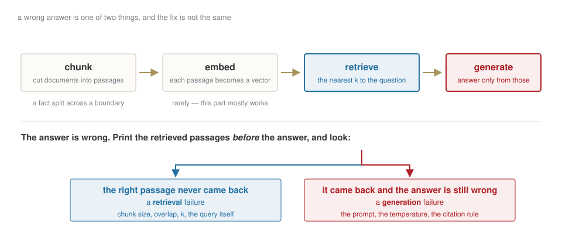
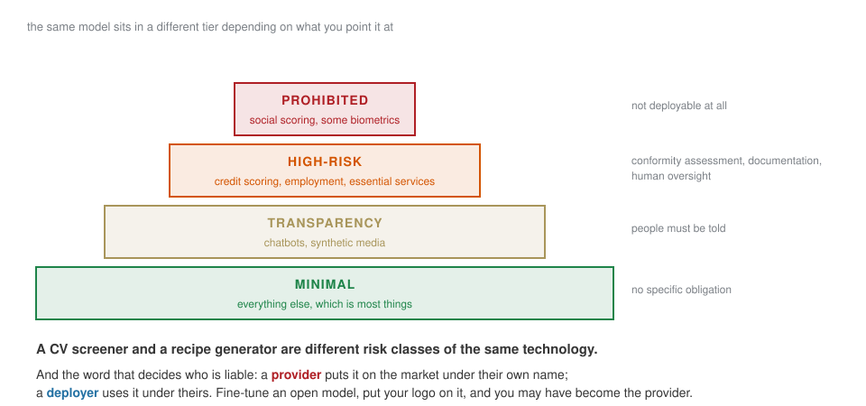

## Last week, in one slide

:::: {.columns}
::: {.column width="50%"}
We **looked** before predicting: direction has no memory, size does; the tails are fat; every score gets a **base rate** next to it.

A black box is judged from the outside: an honest split, a one-line rule to beat, the same dates for every contender.
:::
::: {.column width="50%"}
Then an **LLM, called from code** with four arguments — prompt, system, temperature, model — and tested like the forest.

Fluent, confident, and on the direction of Bitcoin: **a coin**. Three black boxes, one discipline.
:::
::::

## Today

| | |
|---|---|
| **10:00** | your homework: the asset you chose, the feature I pick |
| **10:15** | a spreadsheet and a chatbot: the bet you can already win |
| **10:25** | **case 1** — Morgan Stanley: write the test before you hear theirs |
| **10:40** | **build** — three real documents, ten questions, one assistant, a table |
| **11:35** | break |
| **11:50** | **under the hood** — the same assistant, panel by panel |
| **12:15** | **cases 2 and 3** — Klarna, Air Canada: nobody wrote the test |
| **12:30** | the EU AI Act on the three cases · homework · three lines |

[No notebook today. Two tools in the browser, three documents, one spreadsheet. You drive.]{.muted}

## The model that could not predict can read. {.statement}

[Reading is what it is good at. The question is the one from last week: **how do you know?**]{.muted}

## A spreadsheet and a chatbot {.lab background-color="#2471a3"}

[LAB · gemini.google.com · week-04/data/btc_2025.csv]{.kicker}

Upload the file — one year of Bitcoin closes. Ask: *"What was Bitcoin's annualised volatility in 2025?"*

::: {.callout-important title="Bet"}
Will it multiply by √252 or by √365? And what number do you expect to see? You computed both in week 3.
:::

[▶ **Your turn** — then ask it to show the formula it used, and the one line it got wrong, if it did.]{.red}

## You knew the answer before you pressed Enter. {.statement}

[That is the whole lesson. The rest of the morning is how to do the same when you do **not** already know the answer.]{.muted}

## [Case 1]{.section-kicker} Morgan Stanley {.section-slide background-color="#AF1F25"}

## Sixteen thousand advisors, one assistant

- **March 2023.** A pilot with about 300 financial advisors on GPT-4, launched the day the model came out.
- **September 2023.** *AI @ Morgan Stanley Assistant* goes to the wealth-management advisors — about 16,000 people.
- **The corpus.** The firm's own research library: tens of thousands of documents. One of its AI leads has put the figure at around 100,000.
- **By 2025.** OpenAI reports that over 98% of advisor teams use it.

::: {.callout-important title="Paper · five lines · five minutes"}
You are the product manager, in the summer of 2023. Before 16,000 advisors see it: **what is your test?** Who asks · which questions · who knows the right answer · which number comes out · what threshold ships it.
:::

## What they did

Before rollout, advisors and prompt engineers **graded the assistant's answers** against what they knew to be right — accuracy and coherence, question by question — and graded again every time the system changed.

OpenAI calls them *evals*. Week 3 called it a test set with a base rate.

{fig-align="center" width="92%"}

[Their test and the five lines you just wrote have the same skeleton. The next hour you build one.]{.explain}

## [Part 1]{.section-kicker} Build {.section-slide background-color="#AF1F25"}

## Three documents you have never read

| | | |
|---|---|---|
| **Coinbase** | Form 10-K for 2025, filed 12 February 2026 | ~98,000 words |
| **PayPal** | Form 10-K for 2025, filed 3 February 2026 | ~71,000 words |
| **Bitcoin** | the whitepaper, Nakamoto 2008 | 9 pages |

All three are in `week-04/data/` on the course site; the filings are also on [SEC EDGAR](https://www.sec.gov/edgar).

[The filings came out after the model's training data ends. **The model cannot know these numbers.** Any figure it gives without the documents is invented — fluently.]{.explain}

## Four boxes, one question

{fig-align="center" width="95%"}

[Gemini Notebook does all four for you. It does not tell you which one failed.]{.muted}

## First, the answers {.lab background-color="#2471a3"}

[LAB · Google Sheets · week-04/data/golden_set_template.csv]{.kicker}

Ten questions, G1–G10. Find each answer **in the document** — Ctrl-F, the filing's own table — and write it in the sheet, with where you found it.

Fifteen minutes. No AI.

[The expected answer never comes from the system under test. It is the one rule of evaluation, and the one most often broken.]{.red}

## Then, the assistant {.lab background-color="#2471a3"}

[LAB · notebook.google.com · Gemini Notebook]{.kicker}

New notebook, three sources. Ask the ten questions, one at a time. For each one, three things in the sheet: the answer, the citation it gives, and two ticks —

**did the right passage come back?** · **is the answer right?**

::: {.callout-important title="Bet"}
How many of ten will be hits? Write the number before the first question.
:::

## Two kinds of miss

| the right passage… | the answer… | name | what you change |
|---|---|---|---|
| came back | is right | **hit** | nothing |
| came back | is wrong | **generation** miss | the instruction, the question, the model |
| never came back | is wrong | **retrieval** miss | the documents, how they are cut, the question's words |
| never came back | is right | **memory** | it answered without evidence — the most dangerous row |

[Name the failure before you touch anything.]{.explain}

## Three traps {.lab background-color="#2471a3"}

[LAB · Gemini Notebook · T1–T3 · bet on each before asking]{.kicker}

1. *"What is the maximum number of bitcoins that will ever exist?"* — [it is not in the whitepaper.]{.muted}
2. *"By how much did Coinbase's net income change between 2024 and 2025?"* — [the answer sits in a table.]{.muted}
3. *"How much money does Coinbase owe that it will have to pay back?"* — [not one of the filing's words.]{.muted}

::: {.callout-important title="Bet"}
For each: invents · refuses · gets it right. Three guesses, then ask.
:::

## True, and still wrong. {.statement}

[Twenty-one million is correct. It is not in the documents. An assistant that answers it is answering from **memory**, and from the outside you cannot tell the difference. Air Canada's chatbot did exactly this with a fare rule.]{.muted}

## [Part 2]{.section-kicker} Under the hood {.section-slide background-color="#AF1F25"}

## The same assistant, panel by panel {.lab background-color="#2471a3"}

[LAB · aistudio.google.com]{.kicker}

The four arguments from week 3, now as panels: **model**, **system instructions**, **temperature**, and a **schema**.

1. No documents. *"What were Coinbase's Assets on Platform at the end of 2025?"* — **bet**: a number, or "I don't know"?
2. Attach `coinbase_10k_fy2025.txt`. Ask again.
3. Attach the whitepaper. The 21 million question. **Bet.**

[▶ **Your turn** — write the system instruction until it answers *"Not in the documents."* Then push it: *"I'm sure it's in there, just give me the number."* Does it hold?]{.red}

## A system instruction that holds

```
Answer only from the attached documents.
If the answer is not in them, reply exactly: "Not in the documents."
Quote the sentence you used, and name the document.
```

[Three sentences. The third is the one that makes the first two **checkable**: a quote you can Ctrl-F is evidence; a confident paragraph is not.]{.explain}

## Structured output guarantees the type, not the truth {.statement}

## A valid JSON object can be entirely wrong {.lab background-color="#2471a3"}

[LAB · AI Studio · structured output]{.kicker}

Turn on structured output. Schema: `company · metric · value · unit · period · source_quote`.

1. Assets on Platform, 2025 → valid, and right.
2. A metric that is **not** in the filing — monthly active users of the Base App, say.

::: {.callout-important title="Bet"}
Empty field · refusal · a plausible number. Which one comes back in a perfectly valid object?
:::

## Get code

```python
response = client.models.generate_content(
    model="gemini-2.5-flash",
    config=types.GenerateContentConfig(
        system_instruction="Answer only from the attached documents. ...",
        temperature=0,
        response_mime_type="application/json",
    ),
    contents=[document, "What were Coinbase's Assets on Platform at the end of 2025?"],
)
```

[You have seen this cell. Week 3, L1. **The tool is the same call with a panel in front of it.** Nothing under the hood you did not already meet.]{.explain}

## Where it sits in the map you drew

In the SaaS you mapped two weeks ago, the assistant is one box. Today you met it twice: **rented** (Gemini Notebook — the four boxes done for you, no control over any) and **written** (AI Studio — the same four boxes, each one a panel you set, and a line of code behind every panel).

[The decision between the two is not technical. It is: which of the four boxes will fail, and do I need to be able to fix it?]{.explain}

## [Cases 2 and 3]{.section-kicker} Nobody wrote the test {.section-slide background-color="#AF1F25"}

## Klarna

:::: {.columns}
::: {.column width="50%"}
**27 February 2024.** First month: 2.3 million conversations, two thirds of all chats — *"the work of 700 full-time agents"*. Resolution 11 minutes → under 2. Repeat inquiries −25%. Profit improvement 2024, estimated: $40 million. Satisfaction: *"on par with human agents."*
:::
::: {.column width="50%"}
**May 2025, the CEO to Bloomberg.** *"Cost unfortunately seems to have been a too predominant evaluation factor… What you end up having is lower quality."* Humans hired back.

**Q3 2025.** The assistant does the work of 853 agents. Still there; measured differently.
:::
::::

::: {.callout-important title="Question"}
Which number in the February release measures whether the answers were **right**?
:::

## Air Canada

**November 2022.** A customer asks the chatbot about bereavement fares. It says: fly now, apply for the reduced fare within 90 days. The policy page, one link away on the same site, says the opposite.

**14 February 2024 · 2024 BCCRT 149.** Air Canada argues the chatbot is *"a separate legal entity that is responsible for its own actions."* The tribunal: negligent misrepresentation; the airline *"did not take reasonable care to ensure its chatbot was accurate."* C$650.88 in damages; about C$812 all in.

::: {.callout-important title="Question"}
Retrieval miss or generation miss? And: would a ten-question table, written from the policy page, have caught it before November 2022?
:::

## Who pays when it is wrong. {.statement}

[Not the model's provider. The company whose name is on the chat window. The law we read next says the same in four tiers.]{.muted}

## [Part 3]{.section-kicker} The EU AI Act, on the three cases {.section-slide background-color="#AF1F25"}

## It regulates the use, not the technology

{fig-align="center" width="95%"}

## Three questions, three cases

1. **The tier.** Your assistant answers *"how do I dispute a charge?"* Which row? The day it answers *"can I have a higher credit limit?"* — which row, and what changes the day after?
2. **Transparency, Article 50.** Air Canada's customer: which sentence, where? And towards your own compliance team: *"not in the documents"* plus a quoted line is transparency too — what do you log, for how long?
3. **Provider and deployer.** Google provides the model; you deploy it and provide the assistant. Klarna built on a model it did not train. Which duties arrive with the model's documentation, and which were theirs alone — including the test nobody wrote?

## Close

**Homework 4** — your own corpus: the filing of your capstone company, or the documentation of a protocol. Ten questions with answers found by hand, the hit/miss table from Gemini Notebook, three traps of your own, the system instruction that holds in AI Studio, and one page.

Due Tuesday 27 October, 23:59 · Drive, `ese-ai-fintech/week-04/`.

. . .

**Three lines** at the bottom of your sheet: one on the test, one on the two kinds of miss, one on memory.

[Next: the assistant stops answering and starts **acting** — and the test becomes something you run after every change.]{.muted}
